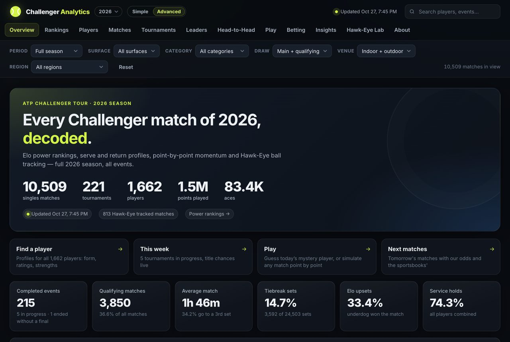
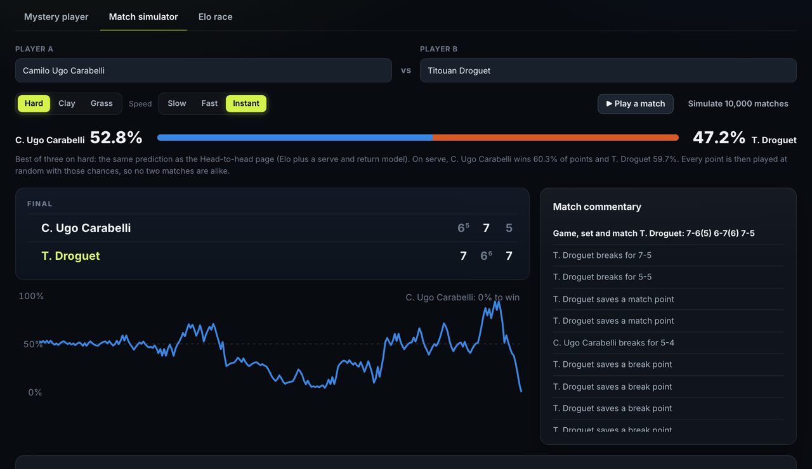
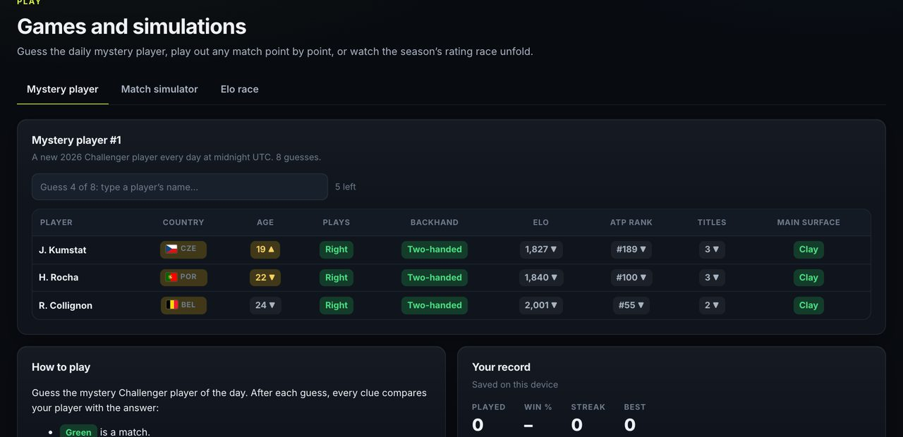
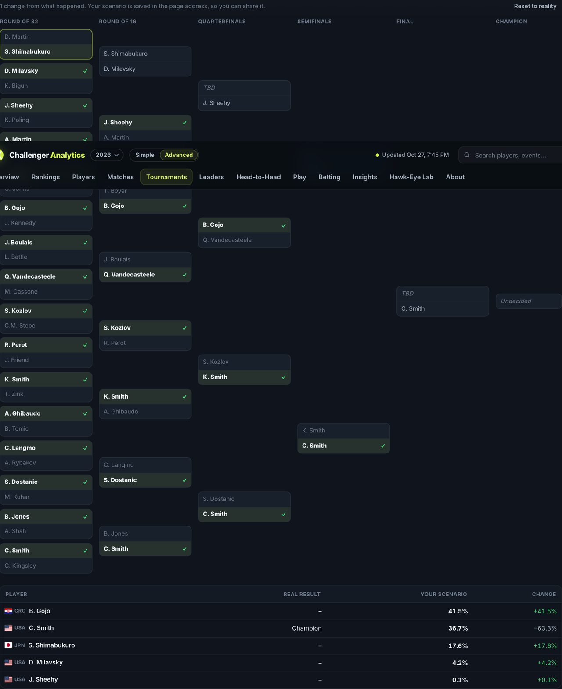

# Challenger Analytics

**Every ATP Challenger Tour match, decoded.** Ratings, point-by-point win probability, title odds for every draw,
player scouting reports, and games and simulations to play with, for the 2025 and 2026 seasons and rebuilt every night.

**Live site: [austinsanalytics.github.io/challenger-analytics](https://austinsanalytics.github.io/challenger-analytics/)**

## What's inside

| | |
| --- | --- |
| **Power rankings** | Elo ratings built from every Challenger match, tuned to minimise prediction error and translated into a familiar scale ("plays like ATP #130") |
| **Player profiles** | A plain-English summary, rating history, serve and return scouting report with tour percentiles, playing-style comparables, and records season by season |
| **Match centre** | Set-by-set stats, how points ended, and a win-probability line through every point, with the moments that swung the match |
| **Tournaments** | Draws, champions, court speed, and each player's title chances before and during the event |
| **Insights** | Upsets, comebacks, seeds vs qualifiers, age curves, nations, the year-over-year changes from 2025 to 2026 |
| **Hawk-Eye Lab** | Serve placement and shot data from tracked events |
| **Simple or Advanced** | A switch between key numbers with plain labels and every column, filter and technical section |

## Play with it

**Match simulator.** Pick any two players and a surface, then play the match out point by point: live scoreboard,
commentary, a win-probability line, and a full stat sheet. Or simulate 10,000 matches to see how often each scoreline happens.
The point odds are calibrated so the simulations agree with the site's prediction for that pairing.

**Mystery player.** A daily guessing game: name the day's Challenger player in eight guesses, with clues on country, age,
hand, rating, ranking, titles and surface. Share your result, keep a streak, or play practice rounds.

**What if?** On any tournament page, change a result or pick winners for matches still to come, and watch every
player's title chances recalculate. Scenarios are saved in the address, so they can be shared.

**Elo race.** Watch the season's top 10 rise and fall week by week, and follow any player through it.

## How it works

- **Data:** match statistics, point-by-point records and rankings from the ATP Tour's public stats pages (with Infosys
  point data and Hawk-Eye tracking where available), collected and rebuilt into this site every night.
- **Elo ratings:** seeded from each player's ATP ranking and carried over from the previous season, with parameters
  tuned by minimising the log-loss of pre-match predictions made from earlier matches only.
- **Win probability:** an exact model of tennis scoring. Each player's serve-point odds are set so the match starts at the
  pre-match forecast, then the probability is recomputed before every point.
- **Title odds:** ATP numbers each draw like a family tree, so every path through it can be weighted by each match-up's
  Elo win chance.
- **Front end:** plain JavaScript modules and hand-drawn SVG charts, with no framework and no build step, served as static files.

## About

An independent fan project, not affiliated with or endorsed by the ATP Tour, Infosys or Hawk-Eye. All match data
belongs to its owners. Any betting information on the site is for entertainment only; 21+, and if gambling is a
problem, call 1-800-GAMBLER.

Built by [AustinsAnalytics](https://github.com/AustinsAnalytics).
